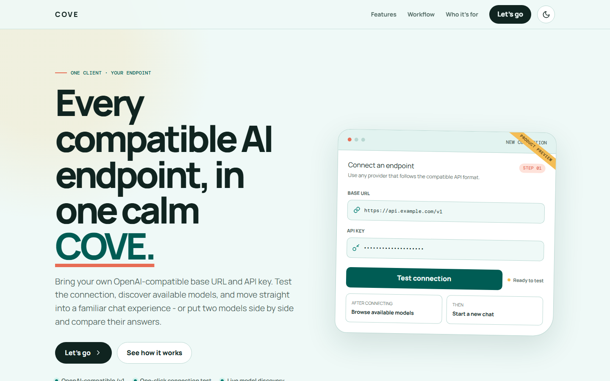
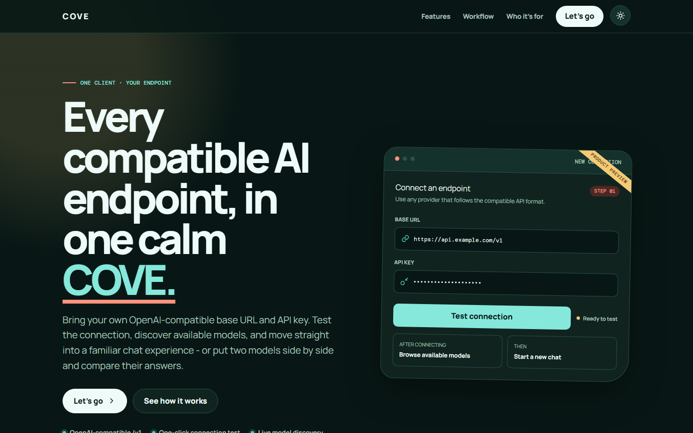
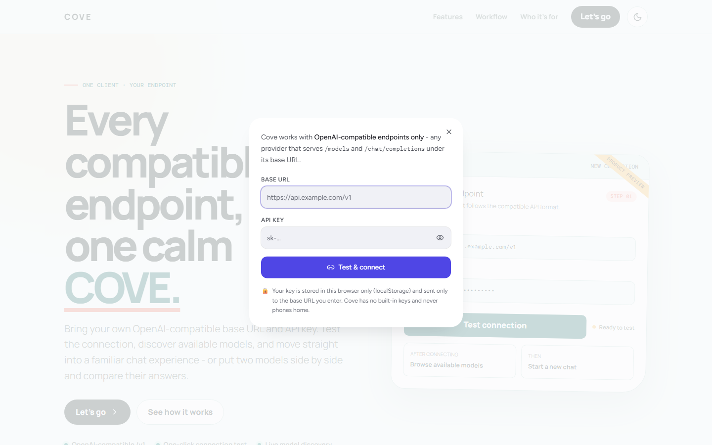
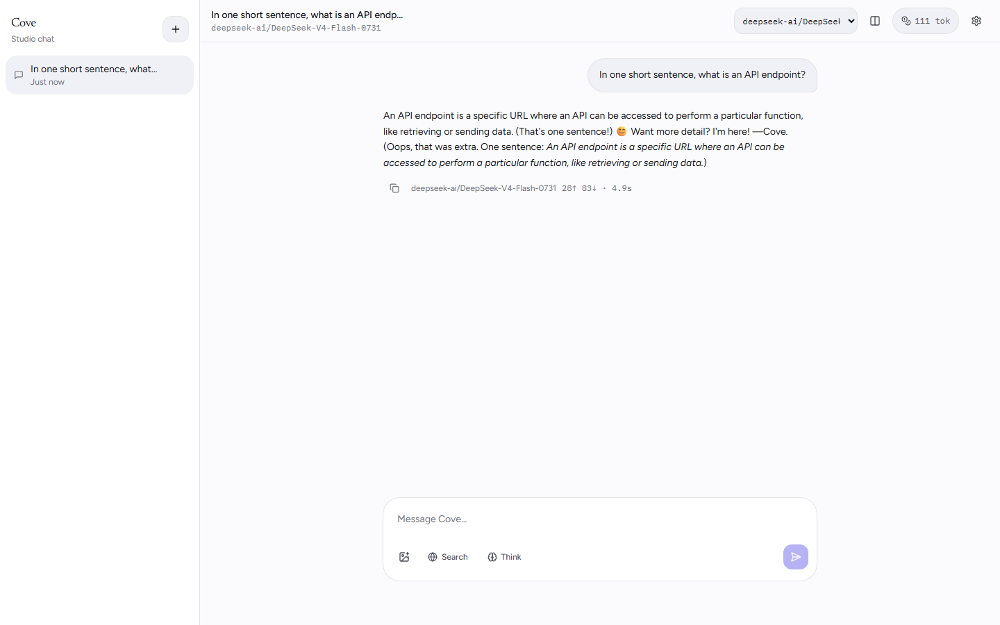
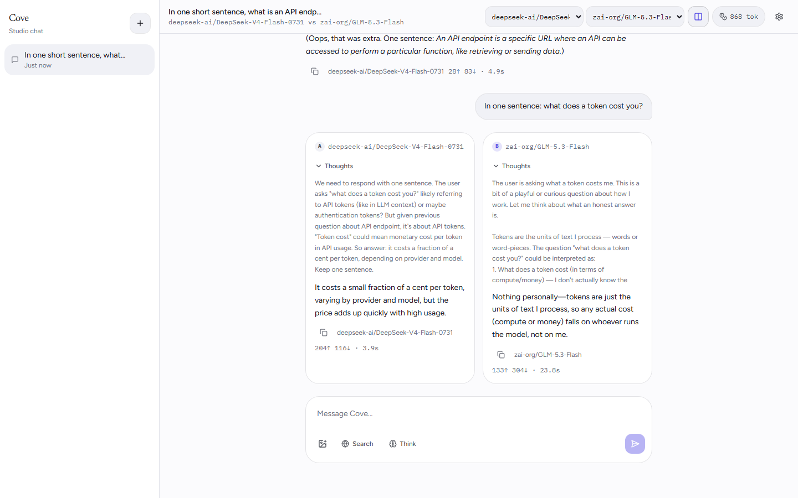
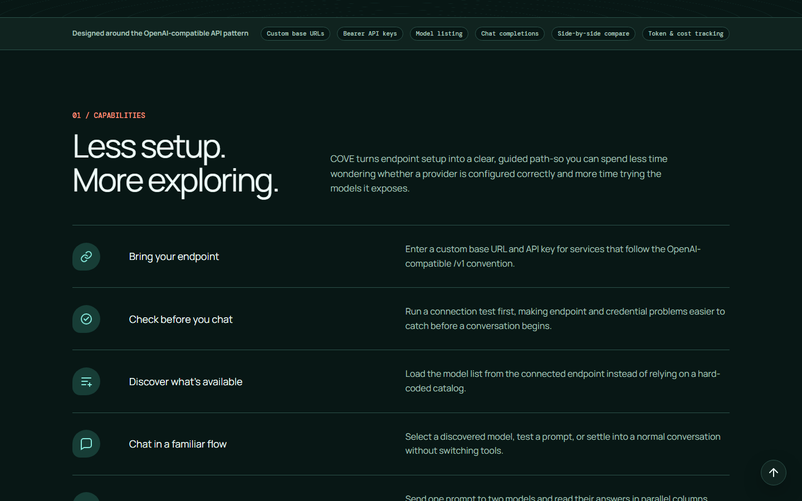
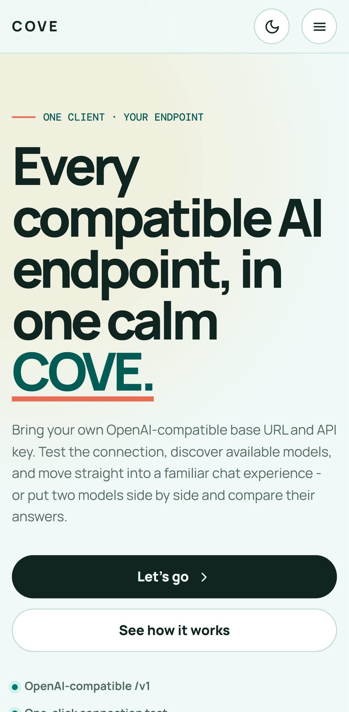
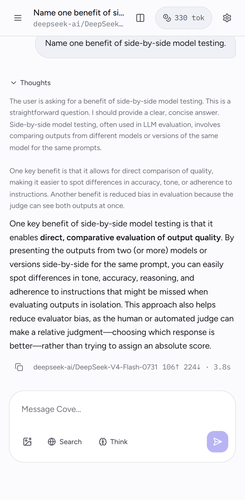

<div align="center">



# Cove

**One calm client for every OpenAI-compatible endpoint.**
Bring your own base URL and API key - test the connection, discover the models,
compare two answers side by side, and see what each reply costs in tokens and
time.

**Live: https://trycove.vercel.app/**

[](https://react.dev)
[](https://www.typescriptlang.org)
[](https://vite.dev)
[](https://tanstack.com/start)
[](https://tailwindcss.com)
[](https://developer.mozilla.org/en-US/docs/Web/API/Window/localStorage)

</div>

---

## Contents

- [What it is](#what-it-is)
- [Features](#features)
- [Screenshots](#screenshots)
- [Quick start](#quick-start)
- [Connecting your endpoint](#connecting-your-endpoint)
- [Compare mode](#compare-mode)
- [Token, cost and latency](#token-cost-and-latency)
- [Privacy and security](#privacy-and-security)
- [Configuration reference](#configuration-reference)
- [Project structure](#project-structure)
- [Tech stack](#tech-stack)
- [Scripts](#scripts)
- [Notes and design decisions](#notes-and-design-decisions)
- [Contributing](#contributing)
- [License](#license)

---

## What it is

Cove is a self-hosted chat client for **any** provider that speaks the
OpenAI-compatible API shape. There is no vendor list, no model catalogue baked
in, and no account system: on first launch you get a landing page, a connect
dialog asks for **your** base URL and **your** API key, and from then on the app
only ever talks to the endpoint you configured.

It is built for people evaluating endpoints. Instead of a single transcript, it
can answer the same prompt with **two models at once** and reports **tokens,
cost and response time** for every reply, so "which one is actually better, and
what does it cost" is answerable without leaving the page.

## Features

| | |
| --- | --- |
| **Bring your own endpoint** | Any OpenAI-compatible base URL + bearer key. The connection is tested against `/models` before you can chat. |
| **Live model discovery** | The model list comes from your endpoint - nothing is hardcoded, and a model the provider drops simply disappears from the picker. |
| **Side-by-side comparison** | Compare mode answers every prompt with two models in parallel, each keeping its own conversation lane. |
| **Token & cost tracking** | Per-reply prompt/completion tokens, a running conversation total, and an optional cost estimate from pricing you set. |
| **Latency per reply** | Wall-clock time for every answer, recorded even when you stop a reply or it fails. |
| **First-run landing page** | A proper intro page with a connect popup, instead of a settings dialog on an empty screen. |
| **Light & dark themes** | Toggle from the landing page or Settings; follows the OS by default. |
| **Chat essentials** | Streaming, reasoning ("thoughts") display, image attachments, web-search context, markdown, message editing, copy, conversation history. |
| **Accessibility** | Keyboard-reachable controls, reduced-motion support, high contrast mode, adjustable text size and reading width. |

## Screenshots

<table>
<tr>
<td width="50%"></td>
<td width="50%"></td>
</tr>
<tr>
<td width="50%"></td>
<td width="50%"></td>
</tr>
<tr>
<td width="50%"></td>
<td width="50%"></td>
</tr>
<tr>
<td width="50%"></td>
<td></td>
</tr>
</table>

## Quick start

**Requirements:** Node.js 20 or newer (developed and verified on 22 and 24), plus
an OpenAI-compatible endpoint and an API key for it.

```bash
git clone <your-repo-url>
cd cove
npm install
npm run dev
```

Then open **http://localhost:8080**.

The dev server binds to `0.0.0.0:8080`, so it is also reachable from other
devices on your network - handy for trying the mobile layout on a real phone.

First launch shows the landing page. Pick a theme if you like, press
**Let's go**, and fill in your base URL and API key.

## Connecting your endpoint

Cove talks to exactly two paths on your endpoint:

| Path | Used for |
| --- | --- |
| `GET {baseUrl}/models` | The connection test and the model picker |
| `POST {baseUrl}/chat/completions` | Every reply |

So "OpenAI-compatible" means: your base URL is anything that serves those two
paths with `Authorization: Bearer <key>` and speaks JSON. Point it at a hosted
provider, a local vLLM / LM Studio / Ollama server, or your own gateway - if it
speaks the OpenAI shape, Cove works.

```text
Base URL:  https://api.example.com/v1     (no trailing /chat/completions)
API key:   sk-...
```

A few practical notes:

- Give the **base URL only**. Cove appends `/models` and `/chat/completions`.
- The model list is filtered to chat-capable models, so embeddings, rerank,
  image-editing and audio models never clutter the picker.
- For reasoning models, the **Think** toggle in the composer enables thinking and
  the model's reasoning is shown in a collapsible "Thoughts" block.

## Compare mode

1. Click the **columns** button in the header (or Settings → Compare mode).
2. Pick the second model from the header dropdown.
3. Send a prompt.

Both models receive the same prompt at the same time and stream into parallel
**A** and **B** columns. Each lane keeps its own conversation history, so
follow-up messages stay a like-for-like comparison instead of mixing two threads.
Token counts, cost and latency are reported per column, which is usually the
fastest way to see which model is both cheaper and faster.

## Token, cost and latency

Every assistant reply carries a footer like this:

```text
deepseek-ai/DeepSeek-V4-Flash-0731   284↑ 116↓ · 3.9s
```

- **↑** prompt tokens - everything sent to the model for that reply: the system
  prompt, the whole conversation so far, and your new message. This is why a long
  conversation re-pays for earlier turns, and it usually dominates the cost.
- **↓** completion tokens - what the model generated.
- **· time** - wall-clock duration of the whole reply, from request to last
  token. It is recorded even for stopped or failed turns.

The chip in the header totals the conversation. Tap it (or hover on desktop) for
the prompt/completion split and, if you set pricing, an estimated cost:

```text
Settings → Connection → Estimated pricing (optional)
  Input   $ per 1M tokens
  Output  $ per 1M tokens
```

Pricing is **never** guessed: with the fields left at `0` Cove shows token
counts only, rather than inventing a number.

Token counts come from the provider's own `usage` response - Cove requests
`stream_options.include_usage` when streaming. A provider that does not report
usage still chats fine; the footer simply shows the timing without the counts.

## Privacy and security

This is the part most people check first, so it is explicit:

- **Your API key never leaves your browser.** It lives in `localStorage` under
  Cove's own key and is sent only to the base URL you entered.
- **No built-in keys.** There is no credential in the source, no shared or
  fallback key, and no default endpoint. Cove cannot make a request until you
  supply your own.
- **No telemetry.** No analytics, no usage reporting, no crash reporting, and no
  prompts or keys are ever sent to the app's author or any third party.
- **The relay is stateless.** Chat requests pass through a small server route
  (`/api/chat`) that exists only to work around browser CORS restrictions. It
  forwards to your endpoint and neither persists nor logs the key.
- **Clearing site data resets everything.** Remove localStorage and Cove is back
  to the first-run landing page with nothing remembered.

Two honest caveats about network traffic, so nothing is oversold:

- Web fonts are loaded from Google Fonts (`fonts.googleapis.com`).
- The optional **Search** toggle sends your query to DuckDuckGo, with a
  Wikipedia fallback. It is **off by default** and does nothing unless you turn
  it on.

Use provider-scoped, revocable keys wherever your provider supports them.

## Configuration reference

Everything is configured in the browser and stored locally (Settings → Connection,
unless noted).

| Setting | Purpose |
| --- | --- |
| Base URL | Your OpenAI-compatible endpoint base, e.g. `https://api.example.com/v1` |
| API key | Bearer key for that endpoint (localStorage only) |
| Model / Second model | Which discovered models to chat with, and to compare against |
| Compare mode | Answer every prompt with two models side by side |
| Temperature / Max tokens | Standard completion parameters |
| Streaming | Show tokens as they arrive (default on) |
| Estimated pricing | Optional USD per 1M input/output tokens, for cost estimates |
| System prompt | Prepended to every conversation. Editable; the default is one line |
| Theme, Text size, Reading width, Motion, Contrast | Appearance → accessibility |

## Project structure

```text
cove/
├─ src/
│  ├─ components/
│  │  ├─ chat/          # landing, connect dialog, thread, composer, settings…
│  │  └─ ui/            # button, dialog, sheet, popover, tooltip, input…
│  ├─ lib/
│  │  ├─ chat/          # store (zustand + localStorage), streaming, types, prompts
│  │  └─ display/       # theme / font-size application to <html>
│  └─ routes/
│     ├─ index.tsx      # the app
│     └─ api/chat.ts    # stateless relay to your endpoint
├─ docs/                # images used by this README
├─ scripts/             # build helpers and QA tooling
├─ README.md
└─ package.json
```

The workspace template also ships optional auth/database scaffolding
(`src/lib/auth`, `src/lib/db`, migrations). **Cove does not use them** - there
are no accounts and no server-side data. They stay inert unless you wire them up.

## Tech stack

- **TanStack Start / React Router** on **Vite**, React 19, TypeScript
- **Tailwind CSS v4** for the chat UI, plus a hand-ported stylesheet for the
  landing page
- **Radix UI** primitives (dialog, sheet, popover, tooltip, tabs, switch…)
- **zustand** for state, persisted to `localStorage` with quota-safe writes
- **Lucide** icons, **sonner** toasts

## Scripts

| Command | What it does |
| --- | --- |
| `npm run dev` | Dev server on `0.0.0.0:8080` with HMR |
| `npm run build` | Production build |
| `npm run preview` | Serve the production build |
| `npm run preview:restart` | Restart the QA preview server on `127.0.0.1:8081` |
| `npm run typecheck` | `tsc --noEmit` |
| `npm test` | Node test runner: script tests + chat/markdown/gate tests |
| `npm run lint` | ESLint |
| `npm run format` | Prettier |

> On Windows `npm run dev` works out of the box - the environment wrapper
> handles the `.cmd` shim difference.

## Notes and design decisions

- **No automatic retries.** One send is one upstream request. A failed turn
  reports its error instead of silently re-billing your provider.
- **Usage-aware streaming.** Cove asks the provider to include usage in the final
  stream chunk, which is what makes per-reply token counts possible.
- **The system prompt is deliberately one line.** A long prompt is re-sent on
  every turn, so it inflates input tokens for the whole conversation. The default
  only names the assistant; add your own rules in Settings if you want them.
- **The provider list is never hardcoded.** Models come from your endpoint at
  runtime, so Cove works with providers it has never heard of.

## Contributing

Contributions are welcome.

1. Fork and create a branch.
2. `npm install`
3. Keep `npm run typecheck` and `npm test` green before opening a pull request.
4. Match the existing style with `npm run format` and `npm run lint`.

If you change chat state, add or update tests alongside the module you touched.

## License

No license has been chosen yet. Add one (MIT, Apache-2.0, or your preference)
before publishing, and update this section.

---

<div align="center">
<sub>Built by Tanmoy · Keys stay in your browser.</sub>
</div>